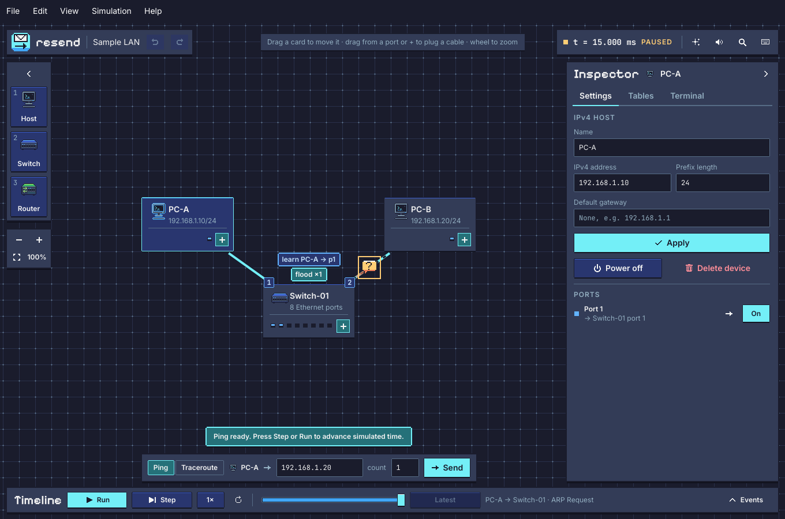

# resend

A desktop networking lab in **C++20 and Slint**, built for creating networks, changing their configuration and understanding why a packet arrives or stops. It is two things in one window: a free sandbox, where experiments come from the network you build, and [guided labs](#labs) for a first networks course, where resend checks each goal on the simulation itself and says why one is not met yet.

resend currently simulates networks of hosts, switches and routers: Ethernet, ARP, IPv4 with default gateways and static routes, ICMP Echo and its errors (Time Exceeded, Destination Unreachable), ping and traceroute. All traffic stays inside the local simulation. The outcome of a ping follows from the state of the network and the modelled protocols. The network can be changed while traffic flows: unplug a cable under a frame, move a PC to another switch port, change an address and watch stale caches mislead the others until they expire, close a loop of switches, or send two routers' default routes at each other and watch the TTL run out. Several pings can run at once; the timeline goes back to any instant of a run and shows every frame field by field, byte by byte. Networks are built on the canvas, saved to files and undone step by step, and every frame can be exported as a capture for Wireshark. Ten labs come with it, from a first network of two LANs and a router to routing loops and reading a traceroute. The interface is in English.

**Verification status (7 November 2026, Linux x86_64, GCC 16 and Clang):** the core, the CLI and the Slint 1.18.1 GUI build without warnings. CTest runs the tests of the core types, the scenario files, the simulation, the live network, routing, the byte encoding, the playback, the canvas, undo and replay, files and recovery, also under AddressSanitizer/UndefinedBehaviorSanitizer; regression tests compare thirty scenarios with golden files, 1,000 random networks, 300 networks edited at random while they run and 200 random routed networks must give the same trace hashes everywhere, Wireshark's `tshark` finds no errors or warnings in the exported captures and agrees with the frame view on every field of every frame of the examples, ICMP errors included. The router examples, built again with Linux network namespaces, put the same frames on every cable as resend: ARP operations, addresses, TTLs, ICMP types and codes and the datagrams the errors quote (`scripts/compare-linux.py`). The GUI tests drive the whole interface on Slint's testing backend, without a display, with accessibility actions and real pointer and key events. CI runs the same suites on Ubuntu and builds the core with MSVC on Windows. The rendering was checked with snapshots from the real renderer; mouse, keyboard and HiDPI scaling have not yet been tested by hand systematically.

**Labs (10 November 2026):** every lab in `labs/` proves itself in CTest, unsolved as given and solved by its own solution; the lab tests cover the files, the locks, the probes and the verdicts' words, and a GUI test builds the first lab from an empty canvas through the build bar, the cards and the inspector. Nobody has done a lab by hand yet.

**Packages (10 November 2026):** the installed layout, the tar.gz and the AppImage's contents were checked on Arch Linux, the last two started with no font on the system; the desktop file and the AppStream metadata pass `desktop-file-validate` and `appstreamcli validate`. The CI jobs added with them have not run yet: the whole app built and tested with MSVC, the Windows zip and installer, the AppImage, and the smoke tests that start the packages on clean Ubuntu 22.04, Ubuntu 24.04 and Fedora 42.

## Install

Packages for Linux x86_64 and Windows x64 are attached to each [release](https://github.com/0xdokkan/resend/releases), with their SHA-256 checksums in `SHA256SUMS`. Until the first one, build resend from source ([below](#building-the-slint-app)).

- **Linux, AppImage** (`resend-VERSION-x86_64.AppImage`), for distributions with glibc 2.35 or later (Ubuntu 22.04, Debian 12, Fedora 36 and newer): make it executable and start it, `chmod +x resend-*.AppImage && ./resend-*.AppImage`. It carries libinput and what libinput needs, and uses the libraries every desktop has: graphics, fonts, keyboard, X11 and Wayland. Where FUSE is missing, `./resend-*.AppImage --appimage-extract-and-run` starts it all the same.
- **Linux, tar.gz** (`resend-VERSION-linux-x86_64.tar.gz`): unpack it anywhere and run `bin/resend`. It is laid out as a prefix: `tar -xzf resend-*.tar.gz --strip-components=1 -C ~/.local` also puts its launcher, icon and AppStream metadata where the desktop finds them. It uses the system's libraries: on Ubuntu and Debian `libfontconfig1 libfreetype6 libgbm1 libinput10 libxkbcommon0 libxkbcommon-x11-0`, on Fedora `fontconfig freetype mesa-libgbm libinput libxkbcommon libxkbcommon-x11`.
- **Windows 10 and 11, installer** (`resend-VERSION-windows-x64.exe`): installs into Program Files with a Start menu entry, a desktop shortcut and an uninstaller. **Zip** (`resend-VERSION-windows-x64.zip`): unpack it anywhere and run `bin\resend.exe`. The packages are not signed, so SmartScreen warns the first time they run: **More info ▸ Run anyway** ([decision 0004](docs/decisions/0004-code-signing.md)).

Without a GPU, or if the window stays empty, Slint's software renderer works everywhere: start resend with the environment variable `SLINT_BACKEND=winit-software`. The packages carry resend, `resend-cli`, the Slint library and the licenses ([`THIRD-PARTY-NOTICES.md`](THIRD-PARTY-NOTICES.md)); a scenario file passed to `resend` is opened at startup.

## Try the sandbox

At startup, `PC-A` (`192.168.1.10/24`) and `PC-B` (`192.168.1.20/24`) are connected to a switch, and the inspector on the right, with nothing selected, tells what to try.



**The HUD.** The network fills the window; around it, a HUD. At the top left the document and undo; at the top right the clock, the command palette (Ctrl+K: every action, found by typing part of its name) and the keyboard shortcuts (`?`); Escape closes any dialog. On the left the build bar (1, 2, 3 add a host, a switch, a router) and the zoom; on the right the inspector, in two tabs, **Settings** and **Tables**; at the bottom the action bar (a ping or a traceroute, from the host selected on the canvas to the address typed) and the timeline with the playback (Run, Step, the speed, Reset), which opens into the events, **Why** and **Frame** (L). A button that shows only an icon says what it does, and its key, when the pointer rests on it, and what an action did, or why it did nothing, is answered in a toast over the action bar. H hides it all, B, I and L fold the build bar, the inspector and the timeline; a window too narrow for the lab panel and the inspector side by side shows the one opened last. A right click on a device, a cable or the background opens a menu of what can be done there, such as **Ping this device**. View ▸ Theme chooses Blueberry, Bubblegum or Picnic, the light one.

1. `PC-A` is selected and `192.168.1.20` is the destination: press **Send** under the canvas. The field next to the address sets how many Echo Requests the ping sends, one a second.
2. Press **Run** to watch the packets travel, or **Step** to play one event at a time: the frame moves along the cable, arrives, and the device's decision appears above it.
3. Click a packet or an event to follow that frame: the cables it crossed light up, the **Why** tab explains what happened and the **Frame** tab shows the frame field by field, as Wireshark names them, next to its bytes. The inspector shows the selected host's ARP cache, with when each entry expires, or the switch's MAC table with the age of each entry, at the instant on the canvas.
4. Drag the slider of the timeline back: the run is replayed up to that instant, and the canvas, the tables and the events show the network as it was. **Latest** brings you back.
5. Change the network while it runs: every change happens at the instant on screen and appears in the events. Click the cable to `PC-B` while a frame is on it and press **Disable cable** in the inspector: the frame is lost on arrival. Power `PC-B` off and it forgets everything it learned; `PC-A` still has `PC-B`'s MAC in its cache, so the next ping times out instead of failing at ARP.
6. Change a prefix or an address in the inspector and press **Apply** to experiment with subnets. After a ping, add a host, give `PC-B` another address and the new host `192.168.1.20`: until `PC-A`'s entry expires, a minute after it was learned, its pings still go to `PC-B`, which ignores them.
7. Pings can overlap: while one is on its way, select another host, change the destination and press **Send** again. Two pings that ask ARP for each other at the same time finish sooner: each host learns the other from its request.
8. Open File ▸ Open example ▸ Switch loop: a broadcast goes round the ring for ever, and resend's storm guard stops it and pauses the playback, in a colour of its own, since that is the simulator stepping in, not the network.
9. Open File ▸ Open example ▸ Two LANs and a router and ping `PC-B`: `PC-A` asks ARP for its gateway, not for `PC-B`, and the router takes the datagram from one LAN to the other with its TTL one lower. Check **Traceroute** under the canvas and press **Trace**: the router answers the first request with a Time Exceeded, `PC-B` the second. Select the router to see its ports, its static routes and its routing table, and change them. Wrong gateway, Missing return route, Routing loop and Longest prefix match are the classic routing mistakes, one per example.

**What the canvas shows.** Each kind of frame is a pixel sprite of its own shape and colour: an envelope with a question mark for an ARP request and one with an exclamation mark for its reply, a ball for an Echo Request and a ring for its reply, an hourglass for a Time Exceeded, a stop sign for a Destination Unreachable ([`docs/sprites.md`](docs/sprites.md)). Broadcast frames carry a ring, the copies a switch floods travel together, the selected frame shows its name, and dashes run along a cable while a frame is on it. A device's sprite shows what it does: its light and screen turn bright when it sends, blue when it receives, red when a frame stops there for a problem; off, it loses its colours. Above a device, short labels show its decisions: `learn PC-A → p1` when a switch binds a MAC to a port, `flood ×2`, `forward → p2`, `filtered`, `entry aged out`, `ARP + 192.168.1.20` when a cache is updated, `ARP entry expired`, `route 10.2.0.0/24 → p2` when a router forwards, a red `×` with the reason when a frame stops (`× TTL exceeded`, `× no route`), each reply, ICMP error or lost request of a ping and its outcome on its source, each hop of a traceroute, changes such as `powered off` in blue, and `storm stopped` in violet. The lights on each card are its ports: blue when connected, amber when the cable is down, lit while a frame passes. Switch and router port numbers appear where the cables meet the card, and a disabled cable carries a cross in its middle.

**Playback.** The clock at the top right of the canvas shows the simulated time on screen. At 1× a 10 ms hop lasts 0.6 s; the speed button cycles from 0.25× to 4×, also in the Simulation menu. When nothing is on the cables, waiting for a timeout lasts at most 0.8 s, however long it is in simulated time, after the last event has played out for 12 ms of simulated time (0.7 s at 1×). Playback only decides when the simulation runs: the result of an experiment never depends on the speed.

**Effects.** What happens has a reaction on the canvas: a pop where a frame arrives, and a spark on the port of a switch that learns an address. A flood fans out from the switch, a frame that stops for a problem leaves a puff, a reply that comes back bursts at its source (confetti for the one that ends the ping), a failed ping shakes its host, and the storm guard flashes the canvas. A goal just met glows, and a solved lab has its moment, then **Watch it again** plays what the check saw. Effects come from the trace and the instant shown, like the packets: dragging the timeline back shows the same ones, and each has a marker or an event beside it. The button beside the clock, the E key and View ▸ Effects choose how much moves: *full*; *reduced*, one instant at a time without moving packets, particles or shaking; *off*, the markers and the texts only. The choice is remembered.

**Sound.** What plays can be heard too. Each frame that reaches a device plays the next note of a pentatonic scale, so pings that run together stay in tune; an ARP request rises and its reply falls; a frame that stops for a problem thuds; the reply that reaches its source resolves the phrase, and a ping that fails sinks instead. A goal met and a lab solved have their jingles, the storm guard an alarm of its own, and buttons click softly. A flood is one chord, cues of one kind closer than 30 ms are one, and at higher speeds the notes are shorter. Dragging the timeline is silent: only what plays is heard. The sounds are synthesized, a few rows of numbers each, with no audio files and no music. The button beside the clock, the M key and View ▸ Sound turn it on and off and set it quiet, medium or loud; the choice is remembered. Without a sound device, or with `--silent`, resend is silent and otherwise the same.

**Reset** keeps the topology and clears the simulation, the events and the learned tables.

**Building a network.** Add hosts, switches and routers from the build bar: each appears in the free place nearest the middle of the view, selected. A host's inspector sets its address and default gateway; a router's sets the address of each port, from two to eight ports, and its static routes, and shows its routing table with the routes it does not use and why, and its ARP cache by port. Drag cards to move them, drag the background to pan, and zoom with the wheel or the controls on the left; **Fit** frames the whole network in the part of the window the HUD leaves free, and until you pan or zoom by hand the network stays framed when the window is resized. When zoomed out, cards show only their icon and name. To plug a cable, drag from a port light or from **+** to another device or one of its free ports, or press **+** on one device and then on another; the first free port is used unless you choose one. Click a cable to select it: the inspector sets its delay, disables it or unplugs it. With the keyboard, Tab goes from card to card, the arrows move the selected one (Shift for small steps), Enter on one device and then on another plugs a cable, Delete removes the selection and Escape cancels. Names and positions change nothing in the simulation; before the first ping a change simply gives a new network, afterwards it happens at the instant on screen and keeps what the network has learned. While changes made later lie ahead of the instant shown, the network cannot be changed: the timeline says so, and **Latest** goes back to the end.

**Undo, files and examples.** Ctrl+Z undoes, Ctrl+Shift+Z or Ctrl+Y redoes, and the buttons at the top left say what they would undo or redo; a drag is one step. While the network runs, undoing makes the inverse change at the current instant. File ▸ Open, Save and Save as use the app's own file dialog; the title bar marks unsaved changes, and resend asks before they are lost or a file is replaced. Unsaved changes are also saved aside every few seconds: if resend closes without saving them, the next start offers them back. File ▸ Open example opens the [example scenarios](#example-scenarios), each with its lesson in the inspector. View folds the build bar, the inspector and the timeline away to give the canvas more room, and chooses the theme. Help ▸ About shows the version, the license and the Slint attribution.

A scenario or a lab file can also be opened at startup, with `--scenario` or on its own:

```sh
./build-gui/resend --scenario examples/office-floor.json
./build-gui/resend labs/missing-gateway.json
```

## Labs

A lab is a network with a task: build it, repair it or observe it, until its goals are met. File ▸ Labs… (or G) lists the ten built in, by topic, with a tick on those solved; the first is offered at the first start. There are three kinds, after the way a first course teaches: **guided** labs walk through each step, and `first-network` says at every step what Packet Tracer would have you type and what does the same in resend; a **challenge** gives the goal and an empty or half-built network; in **troubleshooting** the network is broken and you find why.

The lab panel, on the left of the canvas, holds the brief, the steps, the goals and the hints, one at a time on request. **Check** runs each goal on the network as it is now: a ping or a traceroute on a new simulation of it, from time zero with empty tables, so the same network always gets the same verdict, whatever the run on screen remembers; an address, a gateway, a route, a port or a cable in the network itself; a record of your own run, such as an ARP request sent; an answer you read from the frames, such as a TTL or a MAC. A goal not met says why, from the records that decided it: "PC-A does not reach 192.168.2.10: PC-A's request has no route: PC-A has no default gateway." Devices the lab keeps as it gave them carry a lock in the inspector, and a change to them is refused with the reason. In a lab, new devices can come as out of their boxes, PCs without an address and router ports disabled. **Solution** shows the lab's solution in place of your network, which comes back as you left it; **Restart** starts over.

| Topic | Labs |
| --- | --- |
| First networks | `first-network` (guided), `one-subnet-two-sides`, `missing-gateway` (troubleshooting) |
| Addresses | `ipv4-basics`, `vlsm` (challenges) |
| Routing | `static-routes` (challenge), `missing-return-route`, `routing-loop` (troubleshooting) |
| Observing | `watch-arp-and-ping`, `explain-traceroute` (guided, with answers read from the trace) |

`resend-cli --lab labs/missing-gateway.json --check my-network.json` checks a network against a lab and prints each goal, exiting 0 when all are met; `--answer ID VALUE` gives an answer, and `--verify` checks the lab against its own solution, as CTest does for every lab. The file format, for writing labs, is in [`docs/lab-format.md`](docs/lab-format.md).

## Example scenarios

The files in [`examples/`](examples) are small networks, each with a lesson in its notes; the app has them in File ▸ Open example. Their format is described in [`docs/scenario-format.md`](docs/scenario-format.md).

| File | What it shows |
| --- | --- |
| `sample-lan.json` | The network the app starts with: two PCs on a switch |
| `two-switches.json` | Learning across two switches; the reply is forwarded, never flooded |
| `mismatched-masks.json` | Masks that disagree: ARP works, the reply has no route back |
| `unplugged.json` | A cable down: three ARP requests, then the ping gives up |
| `office-floor.json` | Six PCs on two switches, for several pings at once; one port disabled |
| `switch-loop.json` | Three switches in a ring: a broadcast storm, stopped by the simulator's guard |
| `two-lans-router.json` | Two subnets joined by a router: ARP for the gateway, the TTL going down, traceroute |
| `wrong-gateway.json` | A gateway nobody has, and one on the other subnet: two different failures |
| `missing-return-route.json` | The request arrives, the reply has no way back: the error goes to the destination, not the source |
| `routing-loop.json` | Two routers whose default routes point at each other: the TTL runs out, traceroute shows them taking turns |
| `longest-prefix.json` | Overlapping /8, /16 and /24 routes: the longest prefix that matches decides |

## Building the core and the CLI

You need a C++20 compiler and CMake 3.21 or later. The core, the CLI and their tests do not depend on Slint.

```sh
cmake -S . -B build-core -DRESEND_BUILD_GUI=OFF -DBUILD_TESTING=ON
cmake --build build-core --parallel
ctest --test-dir build-core --output-on-failure
./build-core/resend-cli
```

The CLI runs the sample LAN, or a scenario file, and prints the events with their simulated time, then the outcome of each ping:

```sh
./build-core/resend-cli 192.168.1.20
./build-core/resend-cli 192.168.1.20 --disconnect
./build-core/resend-cli 10.0.0.1
./build-core/resend-cli --scenario examples/two-switches.json --ping PC-C 192.168.1.10
./build-core/resend-cli --scenario examples/office-floor.json --ping Desk-1 10.0.0.22 --ping Desk-5 10.0.0.12
./build-core/resend-cli --scenario examples/unplugged.json --trace
./build-core/resend-cli --check --scenario my-network.json
./build-core/resend-cli --count 4 --at 1.5s --link-down 2 --at 2.5s --link-up 2
./build-core/resend-cli --count 2 --at 500ms --set-ip PC-B 192.168.1.21/24
./build-core/resend-cli --scenario examples/switch-loop.json --ping PC-A 192.168.1.20 --pcap loop.pcap
./build-core/resend-cli --scenario examples/two-lans-router.json --traceroute PC-A 10.2.0.20
./build-core/resend-cli --scenario examples/routing-loop.json --ping PC-A 10.9.9.9
./build-core/resend-cli --scenario examples/wrong-gateway.json --set-gateway PC-C 10.1.0.1 --ping PC-C 10.2.0.20
```

A bare address is pinged from the first host. `--ping NAME ADDRESS` names the source and can be repeated: the pings start together. `--count`, `--interval`, `--timeout` and `--ttl` shape every ping, and the output ends like `ping`'s, with a line per request (`From 10.12.0.2 icmp_seq=1 Time to live exceeded` for an error) and the statistics. `--traceroute NAME ADDRESS` traces the route instead, up to `--max-hops` (30 by default), and prints it as `traceroute -I` does, with `*` for a hop that does not answer and `!N` or `!H` for an unreachable. Changes happen while the simulation runs: `--link-down`, `--link-up` and `--unplug` take a cable id, `--power-off` and `--power-on` a device name, `--set-ip` a host name and an address, `--set-gateway` a host name and a gateway, or `none`; `--at TIME` puts the next ping or change at that simulated time. `--pcap FILE` writes every frame to a capture for Wireshark or tcpdump, and `--pcap-link ID` only those on one cable. `--trace` prints the structured records instead of the explanations, and `--check` only reads and validates the file. The exit code is `0` when every ping succeeded, `1` when one failed, `2` for invalid input and `3` if the simulation does not finish within the CLI's event limit.

## Building the Slint app

On Linux x86_64 you can use the launch script from a terminal with access to GitHub:

```sh
bash scripts/run.sh
```

The script needs a C++20 compiler, CMake, `curl`, `tar` and `sha256sum`. Through `scripts/fetch-slint.sh` it downloads the official Slint 1.18.1 SDK into `.deps/` and checks it against the SHA-256 digest published by GitHub; it then builds into `build/`, runs the tests and starts the app. Arguments are passed on to the executable, for example `bash scripts/run.sh --snapshot /tmp/resend.ppm`.

On its own, `scripts/fetch-slint.sh` prints the directory to pass as `Slint_DIR`:

```sh
cmake -S . -B build-gui -DSlint_DIR="$(bash scripts/fetch-slint.sh)"
```

With a Slint 1.18 C++ SDK already installed, point CMake to it:

```sh
cmake -S . -B build-gui \
  -DCMAKE_PREFIX_PATH=/path/to/Slint-cpp-1.18.1-Linux-x86_64
cmake --build build-gui --parallel
./build-gui/resend
```

Alternatively, CMake can download and build Slint from source. This needs network access to the dependencies, Rust 1.92 or later and the platform's build dependencies. The revision is pinned to Slint 1.18.1, commit `372cf0ee5577c3dfec309a45e7b778ba4e81b734`; the configuration uses the winit backend with the FemtoVG and software renderers, and disables the Qt backend.

```sh
cmake -S . -B build-gui -DRESEND_FETCH_SLINT=ON
cmake --build build-gui --parallel
./build-gui/resend
```

For platform requirements, see the [Slint C++ documentation](https://docs.slint.dev/latest/docs/cpp/).

Sound goes through [miniaudio](https://miniaud.io) 0.11.25, one header that the first configure downloads into `.deps/` and checks against its SHA-256 ([decision 0005](docs/decisions/0005-audio-output.md)); it opens ALSA, PulseAudio or JACK at run time, so nothing more needs installing. Offline, or with `-DRESEND_AUDIO=OFF`, the app is built silent; `-DRESEND_MINIAUDIO_DIR=` points to a copy already at hand.

On Windows, with Visual Studio 2022 and CMake, `scripts/fetch-slint.ps1` downloads the official Slint 1.18.1 SDK, checks its digest, installs it into `.deps\` and prints the directory to pass to CMake:

```powershell
$sdk = ./scripts/fetch-slint.ps1
cmake -S . -B build -DCMAKE_PREFIX_PATH="$sdk"
cmake --build build --config Release
ctest --test-dir build -C Release --output-on-failure
./build/Release/resend.exe
```

### Packages

`cmake --install` lays the app out as a prefix: the programs in `bin/`, the Slint library in `lib/` (found through the programs' `$ORIGIN/../lib` run path; on Windows beside them in `bin/`, with the Visual C++ runtime), and in `share/` the launcher, the icon at every size, the AppStream metadata, the fonts and the licenses. From a build directory, `cpack` makes the tar.gz on Linux and the zip and the installer on Windows (the installer needs [NSIS](https://nsis.sourceforge.io)); `scripts/make-appimage.sh BUILD_DIR` makes the AppImage with `appimagetool`, downloaded at a pinned version and checked against its digest. Built on Ubuntu 22.04, as CI does, the packages run on every newer distribution. A tag `vVERSION` runs CI and attaches its packages to a draft release ([`docs/release-checklist.md`](docs/release-checklist.md)).

### GUI tests

`resend-gui-tests` (run by CTest) uses Slint's testing backend: it opens no windows and needs no display. It finds elements by their accessible labels and drives them the way a user or a screen reader would: buttons, text fields, dragging with pointer events, arrow keys and shortcuts. It covers the canvas (dragging, plugging cables with the pointer and with **+**, deleting), the inspector and its tables, routers (their ports, routes and routing table) and default gateways, pings and traceroute, playback and the storm guard, the timeline's filters and slider, the frame view, undo and redo, saving, reopening and the questions about unsaved changes, autosave and recovery, the examples, the labs (the library, locks, checks, hints and the solution, and the first lab built from an empty canvas), the folding panels down to a 960 × 540 window, the effects and the sound settings, and the About panel with the Slint attribution. It uses folders of its own for the home and the state, so it never touches yours.

For this to work, the code generated by Slint must include element debug information; CMake enables it when `BUILD_TESTING` is on. The `slint::testing` API is still experimental in Slint 1.18.

The testing backend does not render: appearance has to be checked with the real renderer. The `--snapshot` option opens the app, saves a PPM image of the window and exits; it needs a display, unless `--offscreen` is added, which draws in memory at exactly the `--size` given (1360x900 if none is), whatever a window manager would make of the window. With `--ping` (or `--traceroute`) and `--at` it shows a given instant of a ping from the first host, paused, `--select` then selects a device to show its inspector, `--terminal LINE` opens that device's terminal and runs a line in it (give it again for more lines), `--scenario` chooses the network or the lab and `--check-goals` checks a lab's goals. `--click X,Y` clicks somewhere before the picture is taken, to open a menu, and `--point X,Y` rests the pointer there, to show a tip:

```sh
./build-gui/resend --snapshot /tmp/resend.ppm
./build-gui/resend --snapshot /tmp/at-15ms.ppm --ping 192.168.1.20 --at 15ms
./build-gui/resend --snapshot /tmp/office.ppm --scenario examples/office-floor.json --ping 10.0.0.22 --at 6ms
./build-gui/resend --snapshot /tmp/lab.ppm --scenario labs/missing-gateway.json --check-goals
./build-gui/resend --snapshot /tmp/router.ppm --scenario examples/two-lans-router.json --traceroute 10.2.0.20 --at 300ms --select Router
./build-gui/resend --snapshot /tmp/small.ppm --offscreen --size 960x540 --scenario labs/static-routes.json --timeline
./build-gui/resend --snapshot /tmp/terminal.ppm --offscreen --select PC-A --terminal "ip address" --terminal "ping -c 1 192.168.1.20"
```

### Settings and files

Settings (the effects, the sound, the theme and the labs solved) and the files saved aside for recovery live in a state folder: `$XDG_STATE_HOME/resend`, by default `~/.local/state/resend`, on Linux, `%LOCALAPPDATA%\resend` on Windows; the `RESEND_STATE_DIR` variable chooses another one.

## Current model and limits

- At most 100 devices; one Ethernet interface per host, eight ports per switch, two to eight per router. A cable occupies its ports even when disabled.
- The switch learns the source MAC on the ingress port, floods broadcasts and unknown destinations to the other ports, and uses the learned table for unicast. Entries age out after 300 s without a frame from their address (IEEE 802.1Q's default), or the time set in the scenario file.
- Hosts and router ports use static IPv4 addresses with prefixes from `/1` to `/32`. Network, broadcast, loopback and multicast addresses are excluded, except on `/31` and `/32`, which have no network or broadcast address (RFC 3021).
- A host sends a datagram for another subnet to its default gateway, and without one has no route. ARP resolves the next hop, the destination on the same subnet and the gateway otherwise; a host that must reply to an address it has no entry for resolves it first. Entries expire a minute after their last update. While an address is being resolved, up to three datagrams wait for it and a newer one pushes out the oldest; requests are repeated once a second, three times in all. These are the values of common stacks, chosen as model parameters, not universal values set by the protocols.
- Routers forward by the longest prefix match over connected networks and static routes, with a default route as `0.0.0.0/0`, and lower the TTL by one; there is no dynamic routing (RIP, OSPF) or NAT. A router sends Time Exceeded when the TTL runs out, Destination Unreachable (network) without a route and (host) after three unanswered ARP requests, each quoting the whole datagram, but never about an ICMP error or a broadcast; it does not forward directed broadcasts, and sends no redirects. Its errors are not rate-limited.
- A ping sends 1 to 1,000 Echo Requests with 56 bytes of data and TTL 64 (or any from 1 to 255), one per interval; each waits for its reply up to its timeout (both one second by default), and a later reply is ignored; an ICMP error about a request ends it. Traceroute sends one Echo Request per hop, with TTL 1, 2, ..., one at a time, as `traceroute -I` with one probe per hop. Several pings can run at once; datagrams waiting for the same ARP reply share one resolution.
- Each cable adds 10 ms of simulated time by default; scenario files can set any delay from 1 µs to 10 s. A frame on a cable that stops carrying, even for an instant, is lost.
- Loops of switches are allowed. Without spanning tree (STP, future work) a broadcast goes round them for ever, as in a real network; the simulator stops each frame copied more than four times per cable, and at least 64 times, and says so as a simulator event. No artificial TTL is added to Ethernet frames.
- Frames are logical structures, encoded as bytes for captures: MTU and fragmentation, link capacity, queues and random losses are not simulated yet.
- TCP/UDP, IPv6, DHCP/DNS and VLANs are not available yet.
- The file dialog is the app's own: native dialogs come later.

resend implements a teaching subset and claims neither full standards compliance nor compatibility with Cisco IOS. The references used to build and check the modelled behaviour are [RFC 826, ARP](https://www.rfc-editor.org/rfc/rfc826), [RFC 791, IPv4](https://www.rfc-editor.org/rfc/rfc791), [RFC 792, ICMP](https://www.rfc-editor.org/rfc/rfc792), [RFC 1122, Requirements for Internet Hosts](https://www.rfc-editor.org/rfc/rfc1122), [RFC 1812, Requirements for IPv4 Routers](https://www.rfc-editor.org/rfc/rfc1812) and [RFC 4632, CIDR](https://www.rfc-editor.org/rfc/rfc4632), together with their applicable updates; the Linux network stack is the reference where they leave a choice.

## Structure and development

| Path | Responsibility |
| --- | --- |
| `src/core/` | Core types: IPv4 addresses and prefixes, MAC addresses, typed identifiers, simulated time, a seeded random generator, a strict JSON reader and writer, and `tr()` for every text written for people (`text.hpp`) |
| `src/scenario/` | The network as the user builds it: devices, ports, cables and layout; validation, edits and their inverses, and the JSON file format |
| `src/sim/` | The simulation: deterministic scheduler, layered frames, cables, switches, hosts (ARP, IPv4, ICMP, ping and traceroute) and routers (routing table, forwarding, ICMP errors), edits while running, the storm guard and the structured trace |
| `src/wire/` | Frames as bytes, their fields as Wireshark shows them, and pcap captures |
| `src/explain/` | The explanations, built from the trace, and the words of the labs' verdicts |
| `src/lab/` | Labs: their files, the goals checked on probes of the network, the locks |
| `src/app/` | App logic without Slint: the workspace (undo and redo, commands, replay), the canvas controller, playback in simulated time, what the canvas shows at an instant and its effects, the cues heard, event filters, files, autosave and settings |
| `src/audio/` | Sound: the synthesizer, its sounds as rows of numbers, and the output through miniaudio or nowhere |
| `src/app_controller.*`, `src/app_inspector.cpp`, `src/app_documents.cpp`, `src/app_lab.cpp`, `src/app_sound.cpp` | Glue between the app logic and the GUI's models and callbacks: canvas, playback and timeline; the inspector; files, dialogs and settings; the lab panel and the library; what is heard |
| `src/main.cpp` | App startup and its options |
| `ui/` | The interface: `app.slint` (window and menus), `canvas.slint`, `inspector.slint`, `timeline.slint`, `frame.slint`, `dialogs.slint`, `lab.slint`, shared widgets and theme |
| `src/cli.cpp` | Running scenarios without the GUI |
| `examples/` | Example scenario files |
| `labs/` | The labs built into the app |
| `tests/core_tests.cpp` | Addresses, identifiers, durations, scheduler and texts |
| `tests/scenario_tests.cpp` | JSON, validation rules, edits and their inverses, and the example files |
| `tests/sim_tests.cpp` | Network behaviour: concurrent pings, ARP, carrier, delays, and the hash of 1,000 random networks |
| `tests/live_tests.cpp` | The network while it runs: edits, power, expiry and ageing, the ping application, the storm guard, and frame conservation in 300 randomly edited networks |
| `tests/routing_tests.cpp`, `tests/routed_networks.hpp` | Routers: tables and the longest prefix match, gateways, ICMP errors, loops and traceroute, live edits, explanations, and 200 random routed networks |
| `tests/wire_tests.cpp`, `tests/pcap_expert.cmake`, `tests/dissect_tshark.cpp` | Bytes on the wire, captures and fields, checked by hand-computed frames and by Wireshark's `tshark` |
| `tests/regression_tests.cpp`, `tests/golden/` | Thirty scenarios compared with their recorded output |
| `tests/app_tests.cpp`, `tests/canvas_tests.cpp`, `tests/workspace_tests.cpp`, `tests/files_tests.cpp` | Playback and the canvas scene; the canvas controller; undo, commands, replay and filters; files, autosave and recovery |
| `tests/effects_tests.cpp` | The canvas's effects: from their table of records, the same when dragged to as when played, within their budget, at three intensities |
| `tests/sound_tests.cpp`, `tests/golden/cues/` | The cues of five networks compared with their recorded score; what a ping ends on, a trace sound leaves alone, a mix that never clips, nothing heard that is not seen |
| `tests/lab_tests.cpp` | The lab files, the shipped labs, locks, probes, answers and the verdicts' words |
| `tests/gui_tests.cpp` | The interface without a display |
| `scripts/fetch-slint.sh`, `scripts/fetch-slint.ps1`, `scripts/run.sh` | Verified download of the Slint SDK for Linux and for Windows; build, test and launch |
| `scripts/make-appimage.sh`, `packaging/` | The AppImage; the desktop file and AppStream metadata for Linux, the icon and version resource for Windows |
| `.github/workflows/` | CI (`ci.yml`) and the draft releases of tags (`release.yml`) |
| `THIRD-PARTY-NOTICES.md` | What the packages carry besides resend's own code, and under which licenses |
| `scripts/pixel-font-ligatures.py` | Turns off the pixel font's default ligatures, whose "fi" reads as another letter |
| `scripts/compare-linux.py` | Builds the router examples with Linux network namespaces and compares every cable's frames with resend's (`scripts/compare-linux.py build-core/resend-cli`; no root needed where user namespaces are allowed) |
| `spikes/canvas/` | Canvas prototype used to evaluate Slint (`-DRESEND_BUILD_SPIKES=ON`); results in `docs/decisions/0002-ui-toolkit.md` |
| `docs/engine.md` | How the simulation works: scenario, nodes, trace, explanations, the workspace and the determinism rules |
| `docs/scenario-format.md` | The scenario file format |
| `docs/lab-format.md` | The lab file format |
| `docs/roadmap.md` | Milestones up to 1.0, with their tasks and exit checks |
| `docs/release-checklist.md` | How a release is made, and what is checked by hand on clean machines |
| `docs/decisions/` | Design decisions and their reasons, including the license and the name |

CI (`.github/workflows/ci.yml`) builds and tests the GUI on Ubuntu 22.04 (the oldest glibc the Slint SDK supports) and compares the router examples with the Linux stack there, the core under AddressSanitizer/UndefinedBehaviorSanitizer with GCC and Clang, and the core alone with MSVC on Windows. CTest also checks the CLI's exit codes.

The event queue orders operations by simulated time (in nanoseconds) and then by insertion order. The animation runs the simulation up to the instant on screen and never beyond, so how fast you watch never changes the result. Each step writes a structured trace with no text in it: frames sent and received, drops with their reason, switch learning and ageing, ARP cache updates and expiry, routing decisions with the route that matched, each request of a ping and its outcome, edits, and the storm guard. The explanations are built from that trace, and the tests check the trace itself; details are in [`docs/engine.md`](docs/engine.md).

The plan up to 1.0, with the checks that close each milestone, is in [`docs/roadmap.md`](docs/roadmap.md): animated playback, the new core, live faults, a usable sandbox, routers, then distribution. For TCP the baseline reference will be [RFC 9293](https://www.rfc-editor.org/rfc/rfc9293); for IPv6, [RFC 8200](https://www.rfc-editor.org/rfc/rfc8200), with the complementary specifications they need. Every extension must add verifiable behaviour and state the simplifications that remain.

## License

resend's code is released under the [MIT License](LICENSE), © 2026 Zayd Soulmani: you may use, modify and redistribute it, including in closed-source projects, as long as you keep the copyright notice and the license text.

The graphical interface uses [Slint](https://slint.dev), which is not part of this repository: the SDK is downloaded separately, and resend uses it under Slint's Royalty-free License 2.0, which is free for desktop applications provided that the use of Slint is disclosed. resend discloses it with the `AboutSlint` widget in the **About** panel and with the badge below. Anyone distributing their own version of the app must in turn comply with one of Slint's licenses (GPLv3, Royalty-free or commercial). The core and the CLI do not depend on Slint.

The fonts built into the app, in [`assets/fonts/`](assets/fonts) with their license texts, are under the [SIL Open Font License 1.1](https://openfontlicense.org): [Pixelify Sans](https://github.com/eifetx/Pixelify-Sans) (© 2021 The Pixelify Sans Project Authors), [Inter](https://github.com/rsms/inter) (© 2020 The Inter Project Authors) and [JetBrains Mono](https://github.com/JetBrains/JetBrainsMono) (© 2020 The JetBrains Mono Project Authors). The Blueberry theme is based on the [Sweetie 16](https://lospec.com/palette-list/sweetie-16) palette by GrafxKid. The sprites and the app icon are drawn for resend and are under its MIT License.

[](https://slint.dev)
